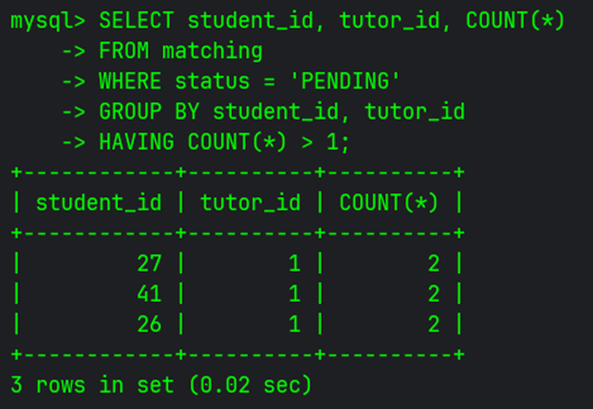
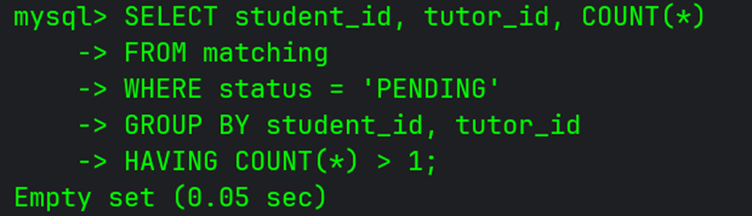
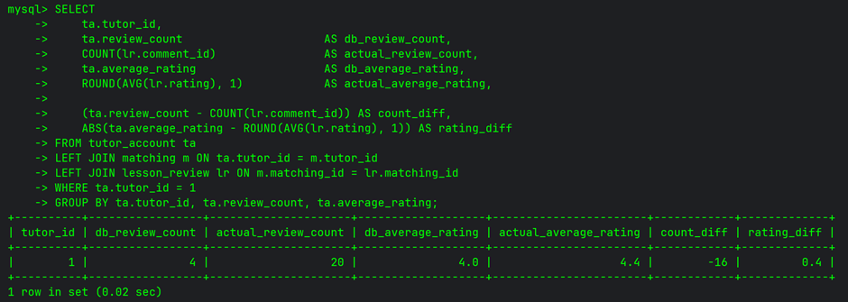
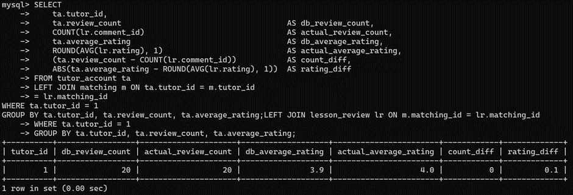
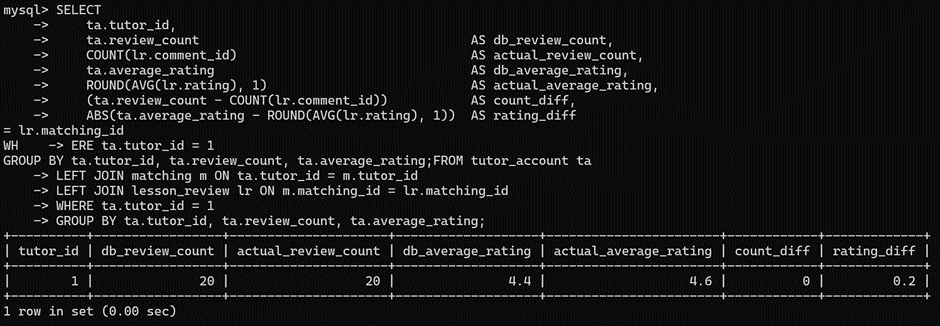
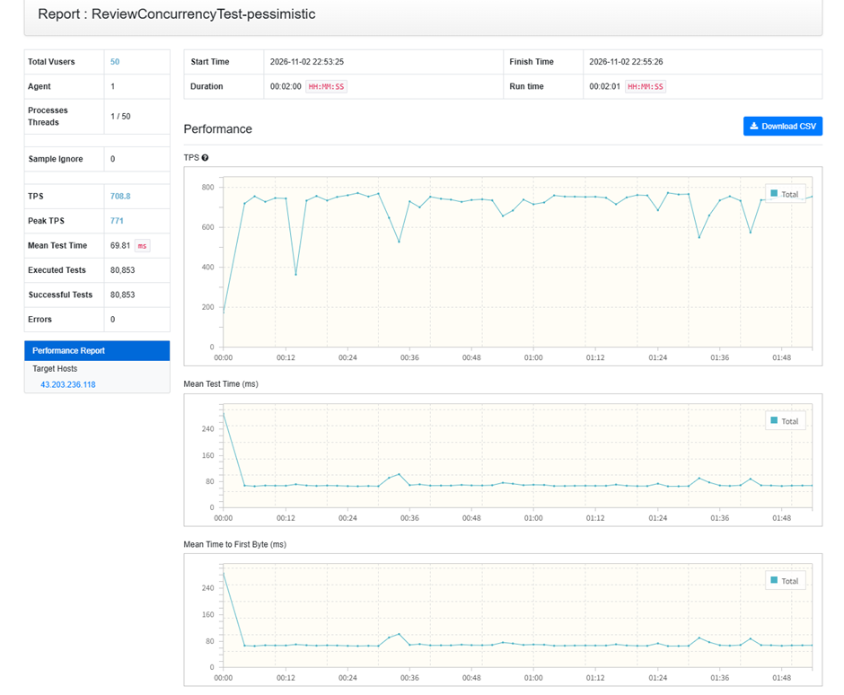
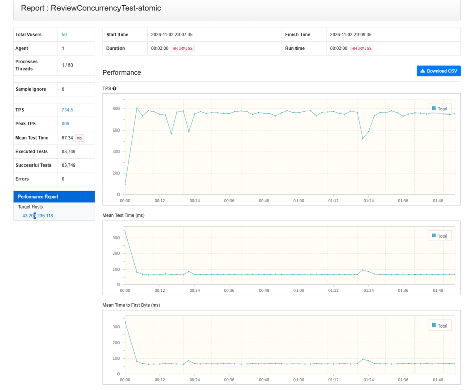
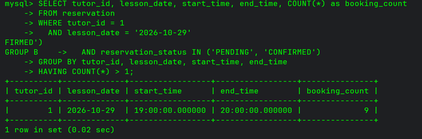
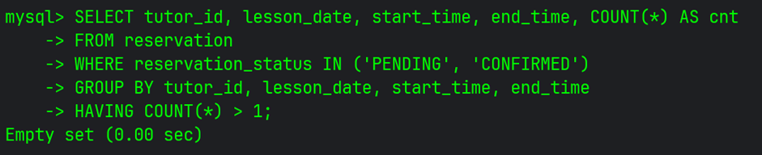

# 동시성 제어 전략 선정 및 Trade-off 분석 (Redis 분산 Lock VS 비관적 Lock VS DB Atomic UPDATE)

> **문서 목적:**  
> **lesson-matching-platform**의 핵심 쓰기 트랜잭션 도메인(매칭 신청, 리뷰 등록, 레슨 예약)에서 발생할 수 있는 데이터 정합성 문제(Race Condition, Double Booking 등)를 해결하기 위해 **왜 분산 락(Redisson), 비관적 락(Pessimistic Lock), DB 원자적 조건부 UPDATE(Atomic Update)**를 각각 선정하였는지에 대한 근거, Trade-off 를 정리. 

---

## 1. 시나리오별 상세 분석 및 검증 체계

### 시나리오 1. 학생의 튜터 매칭 신청 (`MatchingConcurrencyTest`)
> **선택한 방식:** **Redisson 분산 락(Fast-Fail & HikariCP 보호) + DB UNIQUE 제약의 이중 방어**  
> **적용 코드:** [`MatchingLockFacade.java`](../../src/main/java/com/lessonmatchingplatform/lesson_matching_platform/lesson/facade/MatchingLockFacade.java) (`lock:matching:{studentId}:{tutorId}`)

#### (1) 비즈니스 규칙
- 같은 학생이 동일 튜터에게 레슨 매칭 신청 요청을 여러 번 보낼 경우, 현재 진행 중인 **활성 매칭(`PENDING` 또는 `ACCEPTED`)은 오직 1건만 존재**해야 함.
- 매칭이 완료/취소(`CANCELLED`)되거나 거절(`REJECTED`)된 이후에는 동일 튜터에게 재신청이 가능해야 함.

#### (2) 문제 원인
- 동일 학생이 신청 버튼을 연타하여 50~100개의 동시 요청이 쏟아질 때(악의적 매크로 공격), 동시성 제어가 없으면 여러 트랜잭션이 동시에 "활성 매칭 없음"을 확인하고 복수 매칭을 중복 INSERT하는 Race Condition이 발생.
- 부모 행에 비관적 락(`FOR UPDATE`)을 적용할 경우:
  1. **DB 커넥션 풀(HikariCP) 고갈 위험:** 락을 획득하고 대기하는 모든 스레드가 DB 커넥션을 1개씩 쥐고 대기하게 됨. 기본 10~20개 수준인 커넥션 풀을 순식간에 고갈시켜 다른 사용자들의 로그인, 메인 페이지 조회 등 시스템 전체를 마비시킴.
  2. **락의 세분성 문제:** 부모 행인 `StudentAccount` 행을 비관적 락으로 잠그면, 해당 학생이 튜터 A에게 신청하는 동시에 튜터 B에게 다른 레슨을 신청하는 정상적인 행위까지 불필요하게 직렬화되어 블로킹 됨.

#### (3) 해결 방법
- **Redisson 분산 락 도입 (Fast-Fail):**
  - DB 트랜잭션 시작 전(커넥션 획득 전) 애플리케이션 진입로에서 작동. 최초 1개 요청만 DB 커넥션을 맺고 트랜잭션으로 진입하며, 나머지 요청은 DB 커넥션을 전혀 소모하지 않고 Redis 메모리 수준에서 즉시 거절(Fast-Fail).
  - `lock:matching:{studentId}:{tutorId}`와 같이 **[학생 ID + 특정 튜터 ID]의 조합 단위로 정밀하게 락**을 걸어 다른 튜터로의 신청 요청은 완전히 병렬로 처리됨.
- **DB 제약조건과의 '이중 방어' 구축:**
  - MySQL은 `GENERATED ALWAYS AS (CASE WHEN status IN ('PENDING','ACCEPTED') THEN CONCAT(student_id, ':', tutor_id) END) STORED` + `UNIQUE KEY` 설정을 통해 비활성 상태(`NULL`)를 제외한 활성 매칭에 대한 조건부 유니크를 지원.
  - 따라서 **DB 유니크 제약은 데이터 무결성을 보장하는 '최후의 안전망'**으로 두고, **Redisson 분산 락은 DB 커넥션과 CPU를 보호하는 '앞단 방어막(Fast-Fail)'**으로 계층화.
- **예외 처리 및 장애 정책:**
  - **락 획득 실패 시 응답:** 락을 얻지 못한 요청은 `IllegalStateException("현재 매칭 요청을 처리 중입니다. 잠시 후 다시 시도해 주세요.")`을 발생시켜 클라이언트에 **`409 Conflict`** 응답을 반환.
  - **Redis 장애 시 정책 (Fail-Closed):** 매칭 중복 생성은 비즈니스상 심각한 혼선을 초래하므로, Redis 접속 장애 발생 시 요청을 통과시키지 않고 즉시 에러를 반환하는 **Fail-Closed 정책**을 취하며, 혹시 통과하더라도 2차 방어선인 DB 유니크 제약이 데이터 정합성을 최종 방어.

#### (4) 결과
* **테스트 조건:** 동일 학생 계정으로 동일 튜터에게 100회 동시 매칭 신청 (vUser 50~100)
* **정합성 검증 쿼리:**
  ```sql
  SELECT student_id, tutor_id, COUNT(*) FROM matching
  WHERE status IN ('PENDING', 'ACCEPTED')
  GROUP BY student_id, tutor_id HAVING COUNT(*) > 1;
  ```

<br>

| Before (제어 없음 - 중복 레코드 다수 생성) | After (Redisson + DB 유니크 이중 방어 - 1건만 생성) |
|:---:|:---:|
|  |  |

<br>

<details>
<summary><b>🔍 HikariCP 커넥션 풀 실측 로그 비교 (Click)</b></summary>

```log
# Before (제어 없음 - 중복 레코드 다수 생성)
# 커넥션 풀 10개가 100% 고갈(active=10)되고, 최대 40개의 요청이 스레드 락을 쥔 채 커넥션을 대기
2026-11-01T15:23:25.172Z DEBUG 1 --- [onnection adder] com.zaxxer.hikari.pool.HikariPool : HikariPool-1 - Connection not added, stats (total=10, active=10, idle=0, waiting=38)
2026-11-01T15:23:25.200Z DEBUG 1 --- [onnection adder] com.zaxxer.hikari.pool.HikariPool : HikariPool-1 - Connection not added, stats (total=10, active=10, idle=0, waiting=40)
2026-11-01T15:23:25.282Z DEBUG 1 --- [onnection adder] com.zaxxer.hikari.pool.HikariPool : HikariPool-1 - Connection not added, stats (total=10, active=9,  idle=1, waiting=40)
2026-11-01T15:23:25.407Z DEBUG 1 --- [onnection adder] com.zaxxer.hikari.pool.HikariPool : HikariPool-1 - Connection not added, stats (total=10, active=10, idle=0, waiting=39)

# After (Redisson + DB 유니크 이중 방어 - 1건만 생성)
# DB 트랜잭션 진입 전 락 미획득 요청을 즉시 409 반환하므로, 단 1개의 커넥션만 소비하고 대기 요청 0 유지
2026-11-01T15:33:41.244Z DEBUG 1 --- [l-1 housekeeper] com.zaxxer.hikari.pool.HikariPool : HikariPool-1 - Pool stats (total=10, active=1, idle=9, waiting=0)
2026-11-01T15:33:41.245Z DEBUG 1 --- [l-1 housekeeper] com.zaxxer.hikari.pool.HikariPool : HikariPool-1 - Fill pool skipped, pool has sufficient level or currently being filled.
```
</details>

<br>

| 측정 지표 | Before (동시성 제어 없음) | After (분산 락 + DB 유니크 이중 방어) |
|:---|:---:|:---:|
| **중복 레코드 수** | 6건 | **0건** |
| **DB 커넥션 점유 (HikariCP)** | **풀 고갈 및 대기 40개 급증**<br>`active=10, idle=0, waiting=40` | **안정적 유지 (최소 점유)**<br>`active=1, idle=9, waiting=0` |

---

### 시나리오 2. 리뷰 등록 시 평점·리뷰 수 집계 동시성 (`ReviewConcurrencyTest`)
> **선택 및 비교:** **비관적 락(Pessimistic Lock) vs DB 원자적 UPDATE(Atomic SQL Update)**  
> **적용 코드:** [`TutorsRepository.java`](../../src/main/java/com/lessonmatchingplatform/lesson_matching_platform/tutor/repository/TutorsRepository.java#L28), [`ReviewService.java`](../../src/main/java/com/lessonmatchingplatform/lesson_matching_platform/lesson/service/ReviewService.java#L73), [`LessonReviewController.java`](../../src/main/java/com/lessonmatchingplatform/lesson_matching_platform/lesson/controller/LessonReviewController.java#L24)

#### (1) 비즈니스 규칙
- 학생이 레슨 완료 후 리뷰와 별점을 등록하면, 매번 전체 리뷰를 `COUNT/AVG`하는 집계 쿼리를 방지하기 위해 `tutor_account` 테이블에 저장된 **총 리뷰 수(`review_count`)와 평균 평점(`average_rating`) 컬럼이 올바르게 갱신**되어야 함.
- 수십 명의 학생이 거의 동시에 리뷰를 작성하더라도, **작성된 모든 리뷰 건수와 점수가 누락 없이 100% 정확하게 반영**되어야 함.

#### (2) 문제 원인
- **Lost Update 발생:**
  - 동시성 제어가 없는 기본 상태에서는 여러 트랜잭션이 동일한 시점에 `tutor_account` 행을 읽고(`SELECT`), 각각 애플리케이션 메모리상에서 `reviewCount + 1` 및 새 평점을 계산한 뒤 DB에 덮어쓰기(`UPDATE`)를 수행.
  - 그 결과 나중에 커밋된 트랜잭션이 먼저 커밋된 트랜잭션의 변경 사항을 덮어씌우면서, **20명의 학생이 리뷰를 남겼음에도 실제 튜터 테이블에는 단 4건의 카운트만 반영되고 16건의 집계가 증발하는 심각한 데이터 불일치** 발생.

#### (3) 해결 방법
동일한 튜터 행에 집중되는 쓰기 경합을 해결하기 위해 두 가지 방식을 구현하고 비교:

* **Case A. 비관적 락 (`SELECT ... FOR UPDATE`):**
  - `tutorsRepository.findByIdWithLock(tutorId)`를 통해 해당 튜터 행에 배타적 락(X-Lock)을 걸어 평점 갱신 트랜잭션을 직렬화(Serialization).
  - **장점:** 도메인 내부 비즈니스 로직(`tutorAccount.updateRating()`)을 온전히 유지 가능.
  - **단점:** 동시 요청이 많을수록 DB 행 잠금 대기 시간이 길어지며, HikariCP 커넥션 점유 시간이 증가.
* **Case B. DB Atomic Update:**
  - 별도의 행 락 선점 조회 없이, InnoDB 엔진의 Row-level Lock을 활용하여 단 1회의 원자적 쿼리로 카운트와 평점을 즉시 갱신:
    ```sql
    UPDATE tutor_account
    SET review_count   = review_count + 1,
        average_rating = ROUND(
            (average_rating * review_count + :newRating) / (review_count + 1),
            1
        )
    WHERE tutor_id = :tutorId;
    ```
  - **장점:** `SELECT FOR UPDATE` 네트워크 왕복(RTT) 및 DB 락 점유 시간을 최소화하여 높은 처리량(TPS)을 확보.
  - **단점:** JPQL 벌크 연산이므로 1차 캐시 동기화를 위해 `@Modifying(clearAutomatically = true)`가 필수적.

#### (4) 결과
* **테스트 조건:** 동일 튜터에 대해 학생 20명이 동시에 리뷰 등록 및 평점 갱신 요청 (vUser 20)
* **정합성 검증 쿼리:**
  ```sql
  SELECT
      ta.tutor_id,
      ta.review_count                                        AS db_review_count,
      COUNT(lr.comment_id)                                   AS actual_review_count,
      ta.average_rating                                      AS db_average_rating,
      ROUND(AVG(lr.rating), 1)                               AS actual_average_rating,
      (ta.review_count - COUNT(lr.comment_id))               AS count_diff,
      ABS(ta.average_rating - ROUND(AVG(lr.rating), 1))      AS rating_diff
  FROM tutor_account ta
  LEFT JOIN matching m ON ta.tutor_id = m.tutor_id
  LEFT JOIN lesson_review lr ON m.matching_id = lr.matching_id
  WHERE ta.tutor_id = 1
  GROUP BY ta.tutor_id, ta.review_count, ta.average_rating;
  ```

<br>

* **데이터 정합성 검증 (Lost Update 방어 여부):**

| Before (제어 없음 - 16건 갱신 누락 / Lost Update) | After Case A (비관적 락 적용) | After Case B (DB 원자적 UPDATE 적용) |
|:---:|:---:|:---:|
|  |  |  |

<br>

* **성능 및 부하 지표 비교 (vUser 50, 2분간 nGrinder 부하 테스트):**

| Case A: 비관적 락 | Case B: DB Atomic UPDATE |
|:---:|:---:|
|  |  |

- 비관적 Lock 방식을 사용했을 때, Lock을 점유하는 시간이 길어, DB Atomic Update 방식보다 TPS가 더 낮을 것이라고 예상하였음. 그러나, 두 방식의 성능 차이는 거의 없었음. (비관적 TPS: 708.8, DB Atomic Update TPS: 734.5). 아마 트랜잭션 내부에서의 작업이 너무 단순하고 빨라서, 락 점유 시간 측면에서 큰 차이가 없었던 것으로 보임. 만약 트랜잭션에서 I/O작업을 하거나, 외부 서비스를 호출하는 등 Lock을 오래 쥐고 있는 상황에선 DB Atomic Update가 성능상 더 유리할 것으로 예측함.


<br>

| 측정 지표 | Before (동시성 제어 없음) | After Case A (비관적 락) | After Case B (원자적 UPDATE) |
|:---|:---:|:---:|:---:|
| **반영된 리뷰 수 (`review_count`)** | **4건 (16건 유실)** | **20건 (100% 정합)** | **20건 (100% 정합)** |
| **평균 평점 정합성** | 불일치 (데이터 왜곡) | **일치 (정확)** | **일치 (정확)** |
| **평균 TPS (nGrinder)** | - | **708.8 TPS** (Peak 771) | **734.5 TPS** (Peak 806) |
| **평균 응답 시간 (Mean Test Time)** | - | **69.81 ms** | **67.34 ms** |
| **총 실행 테스트 수 (Executed)** | - | 80,853건 | **83,749건** |


---

### 시나리오 3. 레슨 스케줄 예약 시간 슬롯 선점 (`ReservationConcurrencyTest`)
> **선택한 방식:** **상위 엔티티 비관적 락 (Pessimistic Lock on Tutor Row)**  
> **적용 코드:** [`TutorsRepository.findByIdWithLock`](../../src/main/java/com/lessonmatchingplatform/lesson_matching_platform/tutor/repository/TutorsRepository.java#L23), [`LessonMatchingService.lessonScheduleMatching`](../../src/main/java/com/lessonmatchingplatform/lesson_matching_platform/lesson/service/LessonMatchingService.java#L183)

#### (1) 비즈니스 규칙
- 특정 튜터의 동일 날짜, 동일 시간대(예: 10월 15일 19:00~20:00)에 2명 이상의 학생이 동시에 예약을 시도할 때, **단 1명만 예약되고 나머지는 Double Booking으로 거부**되어야 함.

#### (2) 문제 원인
- 복수의 트랜잭션이 동시에 시간대 겹침 조회를 통과하여 동일 시간대에 2건 이상의 중복 예약(Double Booking)을 생성하는 문제가 발생.

- 분산 락 대신 비관적 락을 적용할 때 우려되는 문제 및 차이점:
  - 시나리오 1번처럼 아주 많은 사람들이 몰려 비관적 락을 쥐게 되면 DB Connection pool의 고갈이 생길 수 있음.
  - 또한 **Trade-off (락 대기 병목)** 관점에서, 해당 튜터의 다른 시간대를 예약하려는 학생들까지 동일한 튜터 행 락에 의해 순차 대기할 수 있음.
  - **캐시 선조회의 한계:** 락 획득 전에 캐시를 조회하므로, 튜터가 방금 스케줄/휴무를 변경(Cache Evict)했으나 캐시 TTL이 만료되지 않은 짧은 틈새에는 낡은 스케줄을 기준으로 유효성 검사가 통과할 수도 있는 정합성 한계가 존재.

#### (3) 해결 방법
- **상위 엔티티(튜터 행) 비관적 락 선정 이유:**
  - **불필요한 외부 인프라(Redis) 의존성 및 장애 포인트(SPOF) 제거:** 시나리오 1번은 DB의 2차 최종 방어선이 있었지만, 현재 시나리오에선 존재하지 않음.((tutor_id, start_time, end_time)의 쌍을 DB 차원에서 방어하는 것이 어려웠음.) 따라서 Redis의 분산락을 사용하면, 분산락 자체가 마지막 방어선이므로, SPOF의 문제가 커짐.
  - 비관적 Lock은 "트랜잭션 커밋 완료"와 "락 해제"의 타이밍 불일치 (Race Gap)를 신경 안 써도 됨. (트랜잭션 중간에 Lock이 풀리는 경우, commit 전, 다른 트랜잭션이 Lock을 획득한 후, 중복 체크 실행하여, 중복 없음으로 판단하고 INSERT하는 문제)
- **DB Connection Pool 고갈 및 성능 완화 전략:**
  - connection pool 고갈 가능성을 낮추기 위하여 lock을 쥔 채 실행되는 `existsOverlappingReservation`에 인덱스 처리를 적용.
  - `@Transactional(timeout = 3, isolation = Isolation.READ_COMMITTED)`을 걸어 3초 이상 lock을 못 얻고 커넥션을 쥐고 있으면 강제로 예외 처리하여 connection을 회수하도록 트랜잭션 전체 실행 제한 시간을 3초로 상한 제어. (`findByIdWithLock`은 PK 조회를 수행하므로 레코드 락이 적용되며, gap lock 이슈가 발생하지 않음을 확인.)
  - 튜터 스케줄 및 휴무 조회를 캐시(`ScheduleQueryService`)를 통해 **락 획득 전에 미리 수행**하여 트랜잭션 락 점유 시간을 최소화.
  - 캐시 선조회의 Stale Cache Risk는, 튜터가 스케줄/휴무를 바꾸는 행위가 하루에 몇 번 없는 극히 드문 이벤트이므로 대다수의 예약 요청에 대해 높은 TPS를 보장하기 위해 감수한 의도된 트레이드오프.

#### (4) 결과
* **테스트 조건:** 동일 튜터의 동일 날짜/시간 슬롯에 대해 학생 10명이 동시 예약 시도 (vUser 50, 동일 슬롯 80% 집중)
* **정합성 검증 쿼리:**
  ```sql
  SELECT tutor_id, lesson_date, start_time, end_time, COUNT(*) AS cnt
  FROM reservation
  WHERE reservation_status IN ('PENDING', 'CONFIRMED')
  GROUP BY tutor_id, lesson_date, start_time, end_time
  HAVING COUNT(*) > 1;
  ```

<br>

> 💡 **참고:** 비관적 락을 적용했음에도 MySQL 기본 격리 수준(Repeatable Read)의 MVCC 스냅샷 특성으로 인해 발생했던 Double Booking 이슈와 **Read Committed 격리 수준 도입을 통한 최종 해결 과정**은 **[03-db-isolation-level.md](./03-db-isolation-level.md)** 문서에 상세히 정리되어 있습니다.

| Before (동시성 제어 없음) | After (비관적 락 + Read Committed 적용) |
|:---:|:---:|
|  |  |

<br>

| 측정 지표 | Before (락 미적용 / RR 격리수준) | After (튜터 행 비관적 락 + Read Committed) |
|:---|:---:|:---:|
| **중복 예약(Double Booking) 건수** | **9건 중복 발생 (`booking_count=9`)** | **0건 (`Empty set`, 완전 차단)** |
| **데드락 발생 건수** | 0건 | **0건 (단일 PK 레코드 락)** |

---

## 2. 결과 요약

### 핵심 의사결정 요약

| 시나리오 | 발생 문제 | 선택한 해결 전략 | 선정이유 및 트레이드오프 | 검증 결과 (Before ➔ After) |
|:---|:---|:---|:---|:---|
| **1. 매칭 중복 신청** | 악의적 연타 시 DB Connection Pool 고갈 및 중복 row 생성 | **Redisson 분산 락 (Fast-Fail) + DB 유니크 제약 이중 방어** | • DB 커넥션 획득 전 Redis 수준에서 즉시 거절(Fast-Fail)하여 HikariCP 풀 보호<br>• DB 조건부 유니크 키로 최후의 데이터 무결성 보장 | • 중복 생성: 6건 ➔ **0건**<br>• 커넥션 풀 대기: 40개 ➔ **0개 안정화** |
| **2. 리뷰 수·평점 집계** | 동시 리뷰 등록 시 갱신 분실(Lost Update, 80% 누락) | **DB Atomic Update** | • 비관적 락 대비 락 대기  제거 | • 리뷰 누락: 16건 누락 ➔ **20건 100% 정합**<br>• 비관적 락 대비 성능상 큰 차이는 없음 |
| **3. 레슨 시간 슬롯 선점** | 시간대 겹침(Double Booking) 발생, DB Unique 어려움 | **상위 엔티티(튜터 행) 비관적 락 + Read Committed** | • 시간 범위 겹침(14:00~15:00 vs 14:30~15:30)은 DB 유니크 제약 어려움 ➔ 직렬화 검증 필수<br>• 트랜잭션 생명주기와 락 해제 일치 (Race Gap 제거) | • 중복 예약: 9건 ➔ **0건 (완전 차단)**<br>• 단 1건만 예약 성공, 나머지 정상 거절 |

---