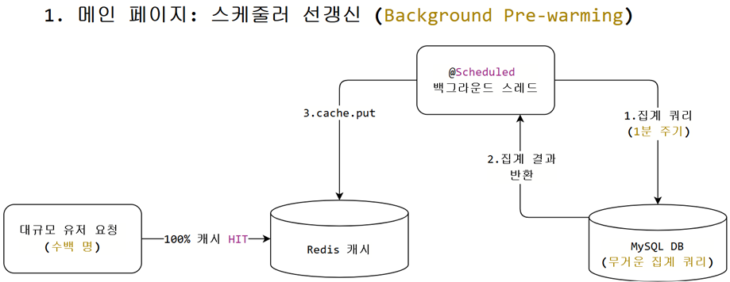
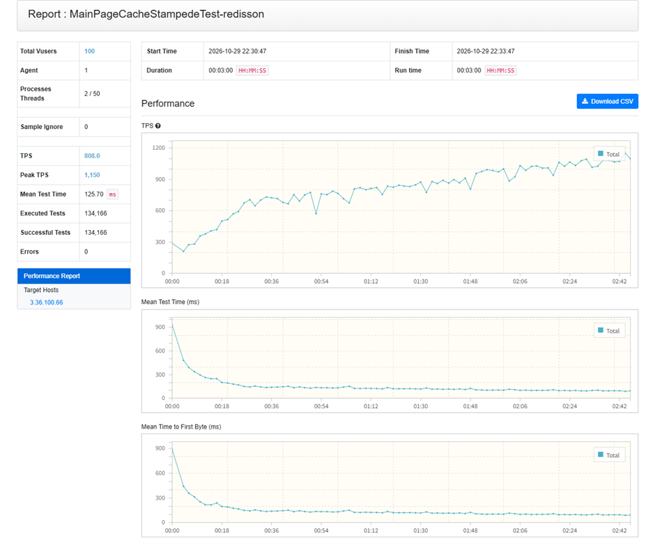
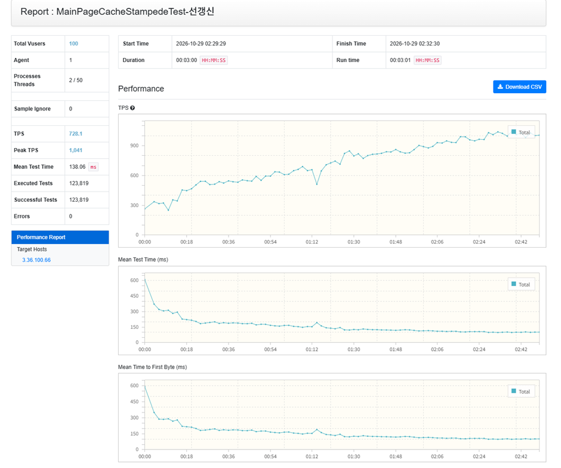
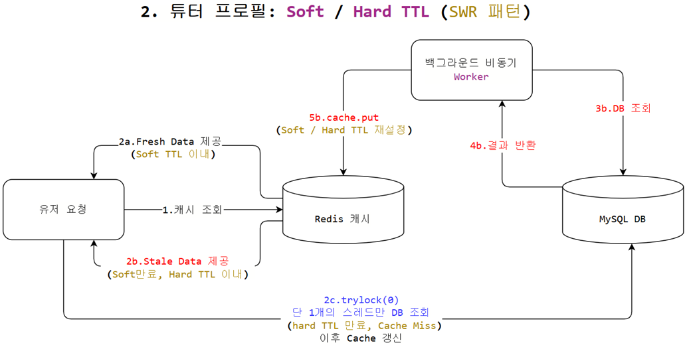
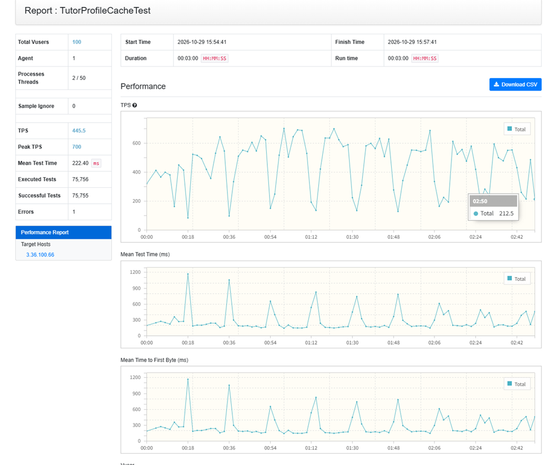
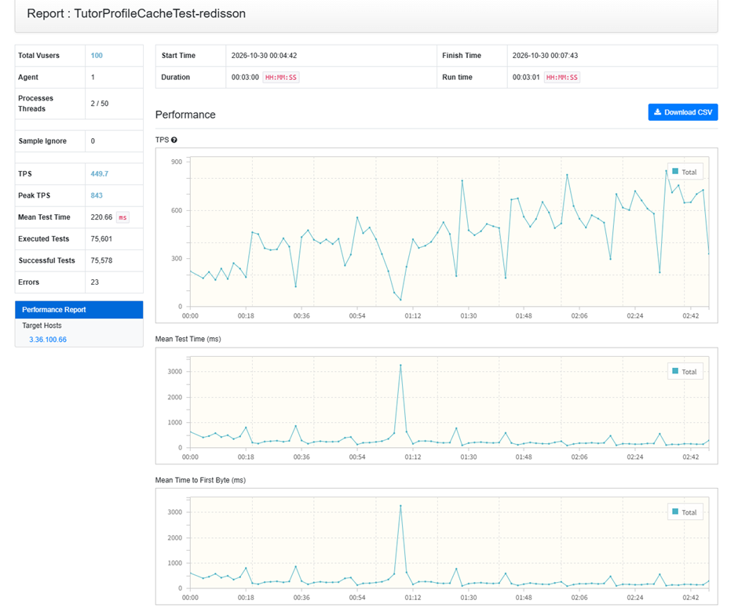
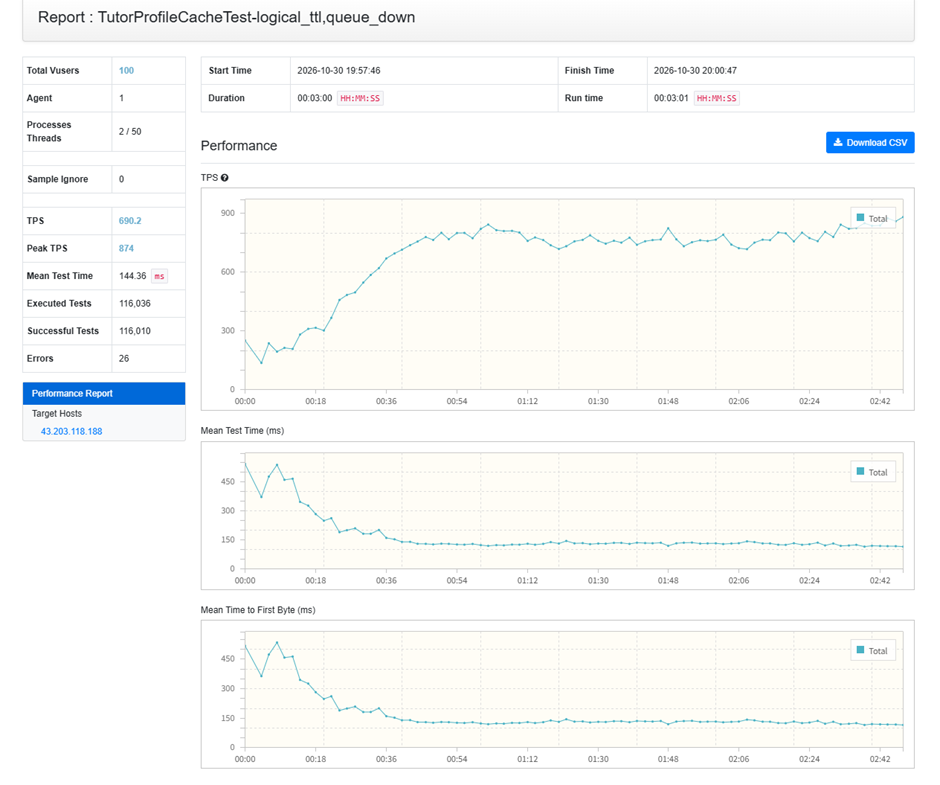

# Cache Stampede 방어 전략 선정 (Redis Scheduler 선 갱신 VS Soft / Hard TTL)

> **문서 목적:**  
> 대규모 트래픽 환경에서 캐시 만료 시 다수의 요청이 동시에 DB로 몰려 DB Connection pool 고갈과 서비스 장애를 유발하는 **Cache Stampede(캐시 스탬피드)** 현상을 해결하기 위해, **메인 페이지(`mainHome`)** 와 **튜터 프로필(`tutorDetail`)** 두 도메인에 각각 서로 다른 방어 전략을 설계한 과정에 대한 정리

---

## 1. 메인 페이지: 스케줄러 선갱신 + Single-Flight Spin-Wait

> **관련 테스트:** `MainPageCacheStampedeTest.groovy`  
> **핵심 구현:** [`MainPageCacheRefreshScheduler.java`](../../src/main/java/com/lessonmatchingplatform/lesson_matching_platform/main/service/MainPageCacheRefreshScheduler.java), [`DistributedCacheLockHelper.java`](../../src/main/java/com/lessonmatchingplatform/lesson_matching_platform/global/cache/DistributedCacheLockHelper.java)

### (1) 비즈니스 규칙
* **키의 특성:** 메인 페이지는 키가 `ALL` 단 1개뿐이며, 서비스에 접속하는 대다수의 사용자가 첫 화면(메인 페이지)으로 진입할 때 보이는 key.
* **DB 쿼리 특성:** 인기 튜터, 신규 튜터 계산을 위한 평점/리뷰/매칭수 복합 정렬 집계 등 **무거운 다중 조인 및 집계 연산**이 수행됨.
* **사용자 경험 목표:** 첫 진입 화면인 만큼, 캐시가 만료되지 않고 계속 채워져 있어야 함.

### (2) 문제 원인
* **대규모 Stampede 폭주:** 키가 1개인 상태에서 캐시가 만료되면, 접속 중인 수백 명의 사용자(테스트 기준 100 vUsers)가 동시에 무거운 집계 쿼리를 DB로 날리는 **Cache Stampede 현상**이 발생.
* **커넥션 풀 고갈 및 지연 급증:** 만료 주기마다 DB 쿼리가 한꺼번에 몰려 DB 커넥션 풀이 순식간에 고갈되고, Connection Timeout으로 인한 5xx 에러 및 극심한 응답 지연이 주기적으로 반복됨.

### (3) 해결 방법
스케줄러 기반의 1차 선제적 방어와 콜드 스타트 상황을 대비한 2차 최후 방어선의 **이중 방어 구조**를 구축.

<br>

<p align="center">
  
</p>

<br>

1. **1차 선제적 선갱신:**
   - 백그라운드 스케줄러(`MainPageCacheRefreshScheduler`)가 운영 Redis TTL(30분)이 만료되기 훨씬 전인 **매 1분마다 DB에서 집계 데이터를 조회하여 캐시를 덮어씀(`cache.put`)**.
   - 사용자는 캐시가 만료되는 순간 자체를 겪지 않으므로, 정상 운영 상태에서는 무거운 집계 쿼리가 사용자 요청 스레드에서 실행되지 않음. (캐시가 비어있지 않고 계속 채워져 있음)
2. **2차 비상 방어선 (콜드 스타트):**
   - 서버 재배포(콜드 스타트)나 Redis 재시작으로 캐시가 비어 있는 상태에서 동시 요청이 유입될 때:
   - **단 1개 스레드만 Redisson tryLock(0)** 을 획득하여 DB 조회를 전담.
   - 락을 얻지 못한 나머지 스레드는 DB로 가지 않고, 최대 3초간 20ms 간격으로 스핀 대기하며 캐시가 채워지기를 기다려 반환받는 **Single-Flight 패턴**을 수행.
   - 락을 획득한 스레드도 DB 조회 직전 **Double-Checked Locking**을 수행하여 이미 선행 스레드가 저장한 캐시가 있는지 확인.

### (4) 결과

#### [부하 테스트 성능 지표 비교 (vUser 100, 3분간 nGrinder 부하 테스트)]

| 2단계: Redisson 분산 락 적용 | 3단계: 스케줄러 선갱신 최종 적용 |
|:---:|:---:|
|  |  |

<br>

<details>
<summary><b>🔍 HikariCP 커넥션 풀 및 캐시 동작 실측 로그 비교 (Click하여 펼치기)</b></summary>

#### ① [1단계 Before] 캐시 스탬피드로 인한 HikariCP 커넥션 풀 고갈 및 30초 타임아웃
100명의 가상 유저가 메인 홈을 동시 요청하여 캐시가 MISS되자, 100개 이상의 스레드가 DB 커넥션을 얻기 위해 대기하다가 30초 타임아웃으로 전원 에러 발생.
```log
# HikariCP 커넥션 10개 100% 점유 및 대기 스레드 125개 초과 (최대 191개 대기)
2026-10-28T14:26:14.855Z ERROR 1 --- [o-8080-exec-481] o.h.engine.jdbc.spi.SqlExceptionHelper : HikariPool-1 - Connection is not available, request timed out after 30000ms (total=10, active=10, idle=0, waiting=125)
2026-10-28T14:26:14.858Z ERROR 1 --- [o-8080-exec-482] o.h.engine.jdbc.spi.SqlExceptionHelper : HikariPool-1 - Connection is not available, request timed out after 30000ms (total=10, active=10, idle=0, waiting=124)
2026-10-28T14:26:14.867Z ERROR 1 --- [o-8080-exec-483] o.h.engine.jdbc.spi.SqlExceptionHelper : HikariPool-1 - Connection is not available, request timed out after 30000ms (total=10, active=10, idle=0, waiting=123)
2026-10-28T14:26:14.876Z ERROR 1 --- [o-8080-exec-485] o.h.engine.jdbc.spi.SqlExceptionHelper : HikariPool-1 - Connection is not available, request timed out after 30002ms (total=10, active=10, idle=0, waiting=121)
```

#### ② [2단계 Redisson 락] 15초 만료 주기마다 정확히 1개 스레드만 DB 조회
다중 인스턴스를 고려하여 Redisson 분산 락을 적용한 결과, 15초 만료 주기마다 수많은 스레드 중 오직 1개의 스레드만 DB를 조회(`concurrent=1`)하고 나머지는 대기하여 커넥션 풀 고갈 방어.
```log
# 약 15초 간격으로 정확히 1개 스레드만 DB 접근 (concurrent=1)
2026-10-29T13:30:58.629Z  WARN 1 --- [io-8080-exec-98] c.l.l.main.service.MainPageService : [CACHE MISS:mainHome][redisson-lock] categoryId=null | concurrent=1 | dbTime=1882ms
2026-10-29T13:31:14.103Z  WARN 1 --- [io-8080-exec-37] c.l.l.main.service.MainPageService : [CACHE MISS:mainHome][redisson-lock] categoryId=null | concurrent=1 | dbTime=257ms
2026-10-29T13:31:29.406Z  WARN 1 --- [o-8080-exec-106] c.l.l.main.service.MainPageService : [CACHE MISS:mainHome][redisson-lock] categoryId=null | concurrent=1 | dbTime=212ms
2026-10-29T13:31:44.641Z  WARN 1 --- [io-8080-exec-19] c.l.l.main.service.MainPageService : [CACHE MISS:mainHome][redisson-lock] categoryId=null | concurrent=1 | dbTime=155ms
2026-10-29T13:32:00.879Z  WARN 1 --- [io-8080-exec-57] c.l.l.main.service.MainPageService : [CACHE MISS:mainHome][redisson-lock] categoryId=null | concurrent=1 | dbTime=174ms
```

#### ③ [3단계 스케줄러 선갱신 최종] 사용자 요청 시 상시 Cache HIT (Cache Miss 0건)
메인 홈 데이터는 키가 1개이고 모든 사용자가 집중 조회하는 특성이 있으므로, TTL 만료 전 백그라운드 스케줄러가 미리 DB를 조회하여 캐시를 선갱신.
```log
# 스케줄러가 백그라운드에서 주기적으로 캐시를 선갱신 완료 (유저 요청 스레드 개입 0)
2026-10-28T17:29:58.324Z  INFO 1 --- [MessageBroker-2] c.l.l.m.s.MainPageCacheRefreshScheduler : [SCHEDULER:mainHome] 선갱신 완료 | key=ALL | elapsed=495ms
2026-10-28T17:30:03.825Z  INFO 1 --- [MessageBroker-2] c.l.l.m.s.MainPageCacheRefreshScheduler : [SCHEDULER:mainHome] 선갱신 완료 | key=ALL | elapsed=995ms
2026-10-28T17:30:08.554Z  INFO 1 --- [MessageBroker-2] c.l.l.m.s.MainPageCacheRefreshScheduler : [SCHEDULER:mainHome] 선갱신 완료 | key=ALL | elapsed=722ms
2026-10-28T17:30:14.144Z  INFO 1 --- [MessageBroker-1] c.l.l.m.s.MainPageCacheRefreshScheduler : [SCHEDULER:mainHome] 선갱신 완료 | key=ALL | elapsed=1314ms
2026-10-28T17:30:18.619Z  INFO 1 --- [MessageBroker-1] c.l.l.m.s.MainPageCacheRefreshScheduler : [SCHEDULER:mainHome] 선갱신 완료 | key=ALL | elapsed=769ms
# ➔ 사용자 요청 로그에서 CACHE MISS가 완전히 사라지고, 상시 100% Cache HIT 상태 유지
```
</details>

<br>

#### [단계별 개선 지표 요약 (Before ➔ Redisson ➔ 스케줄러 선갱신)]

| 비교 항목 | 1단계: 방어 없음 (Before) | 2단계: Redisson 분산 락 적용 | 3단계: 스케줄러 선갱신 최종 적용 |
|:---|:---:|:---:|:---:|
| **평균 TPS** | 0에 수렴 (서버 마비) | **808.0 TPS** (Peak 1,150) | **728.1 TPS** (Peak 1,041) |
| **평균 응답 시간** | **30,000 ms 이상 (타임아웃)** | **125.70 ms** | **138.06 ms** |
| **총 실행 테스트** | 극소수 (대부분 타임아웃) | **134,166건** | **123,819건** |
| **만료 시 동시 DB 쿼리 수** | 100~200건 동시 폭주 | **정확히 1건 (`concurrent=1`)** | **0건 (사용자 스레드 개입 0)** |
| **DB 커넥션 상태 (HikariCP)** | **완전 고갈 (`waiting=125~191`)** | 안정적 (`active=1`, 대기 0) | **상시 유휴 (`active=0~1`, 완전 안정)** |
| **HTTP 응답 및 에러율** | **30초 타임아웃** | **0.0% (에러 0건)** | **0.0% (에러 0건)** |

<br>

#### [단계별 개선 과정 요약]

1. **테스트 환경 구축:**
   - 100명의 가상 사용자(vUsers)가 테스트 TTL(15초) 만료 순간에 동시에 메인 페이지(인기/신규 튜터 복합 집계)를 조회하도록 설정하여 Cache Stampede 환경을 재현.

2. **문제 상황 (방어 미적용 시):**
   - 캐시가 만료되자마자 100여 개의 스레드가 동시에 무거운 집계 쿼리를 실행하여 기본 DB 커넥션 10개가 즉시 100% 점유됨 (`total=10, active=10, idle=0`).
   - 대기 큐에 120개 이상의 요청이 적체되며(`waiting=122~191`), 결국 HikariCP 기본 대기 한도(30초)를 초과하여 전원 Timeout 에러 발생.

3. **1차 개선 (Redisson 분산 락 적용):**
   - Scale-out 환경을 고려해 Redisson 분산 락을 도입. TTL 만료 순간 **오직 단 1개의 스레드만 DB를 조회(`concurrent=1`)**하여 캐시를 채우고, 나머지 스레드는 캐시가 채워질 때까지 대기(Spin-wait) 후 캐시에서 데이터를 읽어가도록 개선.
   - 이를 통해 동시 DB 폭주를 원천 차단하고 HikariCP 커넥션 풀 고갈 문제를 완벽히 해결 (`dbTime=210~250ms`, 에러율 0%).

4. **2차 개선 (스케줄러 선갱신 최종 적용):**
   - 1차 분산 락으로 DB 다운은 막았으나, 락을 획득한 최초 1개 스레드가 DB 조회를 마칠 때까지(약 200ms) 무거운 쿼리 응답을 해야 했음.
   - 메인 페이지는 **모든 사용자가 빈번하게 접근하는 고정된 단일 Key(`mainHome:ALL`)**를 가진다는 도메인 특성에 착안하여, 사용자의 요청이 도달하기 전 **백그라운드 스케줄러가 TTL 만료 전에 캐시를 미리 선갱신(Refresh-Ahead)**하도록 구조 전환.
   - 최종적으로 유저 요청에 의한 **Cache Miss를 0건으로 차단**하여, 100% Cache Hit 상태를 달성.

---

## 2. 튜터 프로필: Stale-While-Revalidate (SWR) + 온디맨드 비동기 갱신

> **관련 테스트:** `TutorProfileCacheTest.groovy`  
> **핵심 구현:** [`DistributedCacheLockHelper.java`](../../src/main/java/com/lessonmatchingplatform/lesson_matching_platform/global/cache/DistributedCacheLockHelper.java#L69), [`TutorsService.java`](../../src/main/java/com/lessonmatchingplatform/lesson_matching_platform/tutor/service/TutorsService.java#L63)

### (1) 비즈니스 규칙
* **키의 특성:** 등록된 전체 튜터 수(`tutorId = 1 ~ 2,000+`)만큼 키가 존재하는 도메인.
* **트래픽 편중:** 상위 10명의 인기 튜터에 80%의 조회가 집중되고, 나머지 1,990명은 간헐적으로 조회되는 편중 분포를 가짐. (테스트 가정 조건)
* **스케줄러 선갱신 적용 불가:** 2,000명의 튜터를 스케줄러로 1분마다 단건 갱신하면 분당 2,000쿼리의 DB 부하가 발생하며, 대부분 아무도 보지 않는 1,990명의 데이터까지 갱신하게 되어 **자원 낭비**.

### (2) 문제 원인
* **핫키 만료 시 경합:** 상위 10명의 인기 튜터 캐시가 만료되는 순간, 해당 튜터를 조회하려는 수십~수백 개의 스레드가 동시에 DB 조회를 시도하여 경합이 발생.

### (3) 해결 방법
실제 요청이 들어온 핫키만 선별적으로 갱신하는 **Stale-While-Revalidate (Soft/Hard TTL) 온디맨드 비동기 갱신 구조**를 구축.

<br>

<p align="center">
  
</p>

<br>

#### 1) 2단계 TTL 분리 설계
* **Soft TTL (15초 - 논리적 신선도):** 애플리케이션 레벨에서 데이터가 신선하다고 간주하는 시간. "Soft TTL 만료 시 + 사용자가 데이터 요청한 경우"에 사용자에게 stale data 즉시 제공 + 백그라운드 비동기 캐시 갱신(on demand 방식).
* **Hard TTL (60초 - 수명 상한):** 백그라운드 갱신이 반복 실패하거나 조회가 끊겼을 때(DB 쿼리 타임아웃, 백그라운드 thread pool 포화 등) 옛 데이터(Stale)를 보장하는 최대 시간. Hard TTL 만료 시, Redis 분산 Lock을 얻은 스레드만 DB조회, 나머지 스레드는 대기 후 캐시를 다시 읽도록 제어

#### 2) 2단계 중복 갱신 차단 및 큐 제어
1. **1차 JVM 레벨 차단:** `ConcurrentHashMap.newKeySet()` 기반의 `refreshingKeys.add()`를 통해 동일 서버 인스턴스 내에서 수백 개의 스레드가 동시에 갱신 큐에 진입하는 것을 메모리 수준에서 O(1)로 차단. (soft TTL 만료 후 수백 개의 스레드가 DB에 갱신을 요청할 때)
2. **2차 분산 환경 차단:** 다중 인스턴스 환경에서 Redisson `tryLock(0)`을 시도하여 단 1개의 서버 인스턴스 스레드만 실제 DB 갱신 쿼리를 실행.


### (4) 결과

#### [부하 테스트 성능 지표 비교 (vUser 100, 3분간 nGrinder 부하 테스트)]

| 1단계: 방어 없음 | 2단계: Redisson 분산 락 | 3단계: SWR Soft/Hard TTL 최종 |
|:---:|:---:|:---:|
|  |  |  |


<details>
<summary><b>🔍 핫키 만료 시 DB 직격 건수 및 직렬화 실측 로그 비교 (Click하여 펼치기)</b></summary>

#### ① [1단계 Before] 방어 로직 부재 시 만료마다 DB 쿼리 폭주 (Cache Stampede)
방어 로직이 없는 상태에서 TTL 15초의 단일 핫키(`tutorId=1`)에 100 vUsers를 3분간 부하한 결과, 캐시가 만료될 때마다 동일 키에 대해 **평균 약 16.6건(최대 26건)의 DB 조회가 동시에 폭주**.
```bash
# 만료 주기(약 17초)마다 다수의 스레드가 동시에 CACHE MISS를 띄우며 DB를 직격
ubuntu@ip-172-31-0-30:~$ docker logs --since 6m spring-app 2>&1 | grep "CACHE MISS" | grep "tutorId=1 |" | awk '{print $1}' | cut -c1-19 | uniq -c
9 2026-10-29T06:54:51
2 2026-10-29T06:55:08 \
8 2026-10-29T06:55:09  > 1회차: 15건
5 2026-10-29T06:55:10 /
1 2026-10-29T06:55:26 \
3 2026-10-29T06:55:27  > 2회차: 8건
4 2026-10-29T06:55:28 /
8 2026-10-29T06:55:45 \
7 2026-10-29T06:55:46  > 3회차: 15건
...
2 2026-10-29T06:57:17 \
9 2026-10-29T06:57:18  > 8회차: 26건 (최대치 피크)
15 2026-10-29T06:57:19 /
```
* **만료 주기당 DB 조회 건수 통계:**
  * 평균: 약 **16.6건** / 중앙값: **16건** / 최대: **26건**

#### ② [2단계 Redisson 락] 15초 만료 주기마다 정확히 단 1개 스레드만 DB 접근
Redisson 분산 락을 적용하여, 캐시가 만료되더라도 **단 1개의 스레드만 DB 조회를 전담하고 나머지는 대기**하도록 직렬화에 성공함.
```bash
# 만료 주기(17초)마다 정확히 1건의 DB 조회만 발생
ubuntu@ip-172-31-0-30:~$ docker logs --since 6m spring-app 2>&1 | grep "CACHE MISS" | grep "tutorId=1 |" | awk '{print $1}' | cut -c1-19 | uniq -c
      1 2026-10-29T15:04:53
      1 2026-10-29T15:05:10
      1 2026-10-29T15:05:27
      1 2026-10-29T15:05:44
      1 2026-10-29T15:06:02
      1 2026-10-29T15:06:18
      1 2026-10-29T15:06:35
      1 2026-10-29T15:06:52
      1 2026-10-29T15:07:08
      1 2026-10-29T15:07:25
      1 2026-10-29T15:07:41
```
* **결과 및 한계:** 동시 DB 쿼리는 26건에서 **정확히 1건으로 억제**하여 DB 다운은 방지했으나, 1개 스레드가 DB를 읽는 동안 나머지 수십 개 스레드가 대기(Spin-wait)해야 하므로 **TPS 급락(100 이하) 및 응답 지연 현상은 여전히 존재**

#### ③ [3단계 SWR 도입] 백그라운드 비동기 갱신 동작 검증
사용자 요청 스레드는 Soft TTL 만료 시에도 즉시 Stale 데이터를 반환받아 응답 지연이 발생하지 않으며, 백그라운드 전용 스레드풀(`cache-refresh-N`)이 비동기로 DB를 갱신함을 확인.

```bash
# [SWR 백그라운드 비동기 갱신 로그] 유저 스레드가 아닌 전용 풀 스레드가 비동기 갱신 전담
2026-10-30T10:08:10.944Z  INFO 1 --- [cache-refresh-8] c.l.l.tutor.service.TutorProfileLoader : 🔄 [CACHE REFRESH] 백그라운드 DB 갱신 발생! tutorId=1 | thread=cache-refresh-8 | 누적DB조회수=2371
2026-10-30T10:08:41.607Z  INFO 1 --- [cache-refresh-3] c.l.l.tutor.service.TutorProfileLoader : 🔄 [CACHE REFRESH] 백그라운드 DB 갱신 발생! tutorId=1 | thread=cache-refresh-3 | 누적DB조회수=2887
2026-10-30T10:09:07.987Z  INFO 1 --- [cache-refresh-7] c.l.l.tutor.service.TutorProfileLoader : 🔄 [CACHE REFRESH] 백그라운드 DB 갱신 발생! tutorId=1 | thread=cache-refresh-7 | 누적DB조회수=3476
```
* **결과 및 한계 (새로운 병목 발견):**
  * 유저 요청 스레드의 지연은 해소되었으나, Soft TTL이 15초임에도 **실제 백그라운드 갱신 간격이 25~28초로 약 10초 이상 지연**되는 현상 식별.
  * 이는 백그라운드 스레드풀의 대기 큐 크기(200개)로 인한 병목이었으며, 상세 원인 분석 및 **큐 축소(200 ➔ 30) 튜닝 과정은 아래 [4.2 트러블슈팅 ②]에서 상술**.
</details>

<br>

#### [단계별 성능 및 안정성 지표 요약]

| 비교 항목 | 1단계: 방어 없음 (Before) | 2단계: Redisson 분산 락 적용 | 3단계: SWR Soft/Hard TTL 적용 |
|:---|:---:|:---:|:---:|
| **평균 TPS (nGrinder)** | 445.5 TPS (Peak 700) | 449.7 TPS (Peak 843) | **690.2 TPS (Peak 874)** |
| **평균 응답 시간 (Mean Test Time)** | 222.40 ms (최대 1,200ms) | 220.66 ms (최대 3,200ms) | **144.36 ms** |
| **총 실행 테스트 (Executed Tests)** | 75,756건 | 75,601건 | **116,036건** |
| **만료 주기당 DB 쿼리 수** | **20~37건 동시 몰림 (스탬피드)** | **1건 (단일 스레드 조회)** | **1건 (백그라운드 스레드 비동기 갱신)** |
| **TPS 톱니바퀴(급락) 현상** | 만료(15초)마다 100 이하로 폭락 | 락 대기로 인해 100 이하로 폭락 지속 | **급락 없이 평탄 유지** |
| **사용자 체감 지연** | DB 동기 조회 대기로 지연 발생 | 락 획득 스레드 대기로 지연 발생 | **Stale Data 즉시 반환으로 지연 없음** |

<br>


* **지연 없는 옛 데이터 서빙 (Stale Serving):** Soft TTL이 만료되더라도 사용자는 DB 조회를 대기하지 않고 이전 캐시(Stale)를 수 ms 만에 즉시 반환받으므로 레이턴시 스파이크가 소멸됨.
* **정량적 안정성 확보:** 100 vUsers 편중 부하에서도 만료당 DB 조회가 **단 1건으로 억제**됨.
* **자원 낭비 원천 차단:** 2,000명의 튜터를 무차별 선갱신하지 않고, 오직 실제로 조회가 유입된 핫키 튜터들만 비동기로 갱신하여 편중 분포 환경에서 효율적인 시스템 갱신 달성.

---

## 3. 추가 트러블슈팅

### 1) 실제 실험을 통해 도출한 3가지 실패 극복기
#### ① `tryLock(3초)` 대기 방식의 Stampede 재발 → `tryLock(0)` + 20ms 스핀 대기 전환
* **실패 원인:** 초기에는 락을 획득하지 못한 스레드가 `tryLock(3, TimeUnit.SECONDS)`로 대기하도록 구현. 그러나 인기 튜터의 캐시가 만료되었을 때, 1번 스레드가 DB를 조회하는 동안 3초 타임아웃이 초과된 26~48개의 대기 스레드가 일제히 락을 포기하고 DB로 직행하여 2차 Stampede가 발생.(Redisson lock을 얻은 스레드가 DB를 조회하여 Redis를 채우는 데 3초 이상 걸리는 경우에 나머지 스레드들이 DB에 몰려서 발생한 것으로 보임.)
* **해결책:** 락 획득 시 대기시간을 0초(`tryLock(0)`)로 설정하여 즉시 분기하고, 락 실패자는 DB로 직행하지 않고 Redis 캐시를 20ms 간격으로 확인하는 **Spin-Wait Polling(Single-Flight)** 으로 수정하여 DB 직행 누수를 차단.

#### ② 갱신 스레드풀 큐 포화에 따른 최신성 지연 → 큐 축소 (200 → 30)
* **실패 원인 및 현상 분석:**
  - SWR 적용 초기, Soft TTL(15초) 만료 시 약 15초마다 갱신이 발생해야 하나 실제 로그에서는 **25~28초 간격으로 약 10초 이상의 심각한 지연이 관측**됨.
  - 로그의 `누적DB조회수` 증가량(약 520~600건 증가)을 분석한 결과, 편중 분포 특성상 일반 튜터들의 갱신 요청까지 겹쳐 **초당 약 20~26건의 DB 갱신 작업이 유입**되고 있었음.
  - 테스트 환경상 DB 조회에 `Thread.sleep(150ms)`가 포함되어 있어, 스레드풀 8개로는 초당 최대 약 53건 처리가 물리적 한계였음.
  - 이로 인해 크기가 200이었던 대기 큐가 항상 가득 찼음.
  - **수학적 대기시간 검증:**
    $$\text{작업 대기시간} = \frac{\text{대기 큐 크기 (200)}}{\text{초당 갱신 처리 속도 (20 - 26건)}} \approx 8 \sim 10\text{초}$$
    실제 관측된 지연 시간(25~28초 - 15초 = 10~13초)과 이론적 큐 대기시간(8~10초)이 거의 일치함을 확인.
* **해결책 및 최적화:**
  - `ArrayBlockingQueue` 크기를 200에서 **30으로 대폭 축소**하여 **최대 큐 대기시간 상한을 약 1.3초로 제한** ($30 \div 23 \approx 1.3\text{초}$).
  - 거절된 갱신 요청은 다음 사용자 조회 시 자연스럽게 재시도되므로 큐를 길게 유지할 필요가 없음.
  - **최종 검증 결과:**
    - 평균 갱신 간격이 **25~28초에서 18~20초로 단축 (약 8초의 지연 해소)**.
    - 15초 딱 맞춤이 아닌 18~20초인 이유는 **`Soft TTL(15초) + 큐 대기(1초) + 요청 인입 및 DB 쿼리(2~3초)`**가 결합된 정상적인 물리적 한계치임.
    - `cache-refresh-1~8` 범위 내에서 스레드가 안정적으로 재사용되며, **스레드풀 포화 경고 로그가 0건(`grep -c ➔ 0`)으로 해소**됨.

* **스레드풀 큐 튜닝(200 ➔ 30) 전/후 갱신 주기 실측 비교:**

| 갱신 회차 | 튜닝 전 (큐 200개) 발생 간격 | **튜닝 후 (큐 30개) 발생 간격** | 비고 |
|:---:|:---:|:---:|:---|
| 1회 | - | - | 10:58:14 |
| 2회 | 26초 | **21초** | 지연 5초 단축 |
| 3회 | 28초 | **17초** | 지연 11초 단축 (Soft TTL 15초에 근접) |
| 4회 | 26초 | **20초** | 지연 6초 단축 |
| 5회 | 24초 | **21초** | 지연 3초 단축 |
| 6회 | 25초 | **19초** | 지연 6초 단축 |
| 7회 | 22초 | **19초** | 지연 3초 단축 |
| **평균 간격** | **25 ~ 28초 (약 10초 이상 지연)** | **18 ~ 20초 (이상적인 물리 한계 달성)** | **지연 시간 약 8초 단축!** |

---

## 5. 결과 요약

### 핵심 의사결정 요약

| 도메인 | 발생 문제 | 선택한 해결 전략 | 선정이유 및 트레이드오프 | 검증 결과 (Before ➔ After) |
|:---|:---|:---|:---|:---|
| **1. 메인 페이지 (`mainHome`)** | 만료 순간 100~200명 동시 조회로 HikariCP 30초 타임아웃 및 서버 마비 | **스케줄러 선갱신 (1차) + Single-Flight Spin-Wait (2차)** | • 고정 단일 Key(`mainHome:ALL`)이므로 주기적 갱신 비용이 매우 낮음 (분당 1쿼리)<br>• 유저 요청 경로에서 만료 경험 자체를 없앰(100% Cache Hit)<br>• 콜드 스타트 시 Redisson Lock으로 단 1건만 DB 조회 | • 커넥션 고갈: `waiting=191` ➔ **0개**<br>• 만료 시 DB 조회: 100~200건 폭주 ➔ **0건 (유저 요청 기준)**<br>• 에러율: 30초 타임아웃 ➔ **0.0%** |
| **2. 튜터 프로필 (`tutorDetail`)** | 핫키 만료 시 DB 20~26건 중복 조회 및 Lock 대기로 인한 TPS 급락 (100 미만) | **Stale-While-Revalidate (SWR 3단계 TTL) 온디맨드 비동기 갱신** | • 수천 개 키의 편중 분포로 스케줄러 일괄 갱신 불가<br>• Soft TTL 만료 시 이전 캐시(Stale) 즉시 서빙으로 지연 0ms<br>• 백그라운드 스레드풀 큐 튜닝(200➔30)으로 Head-of-Line Blocking 해소 | • DB 중복 조회: 주기당 26건 ➔ **1건 직렬화**<br>• 평균 TPS: 445.5 ➔ **690.2 TPS (+55%)**<br>• 응답 시간: 222ms ➔ **144ms (-35%)**<br>• 갱신 지연: 28초 ➔ **18~20초 (8초 단축)** |