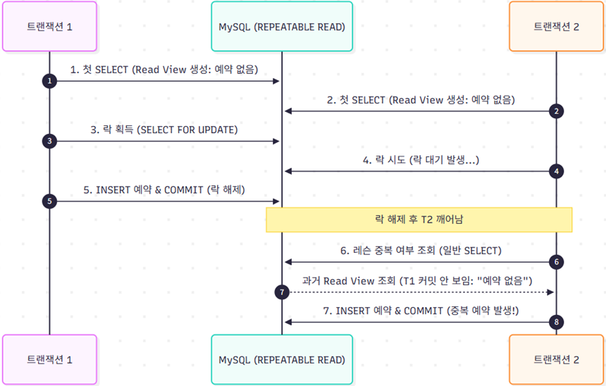
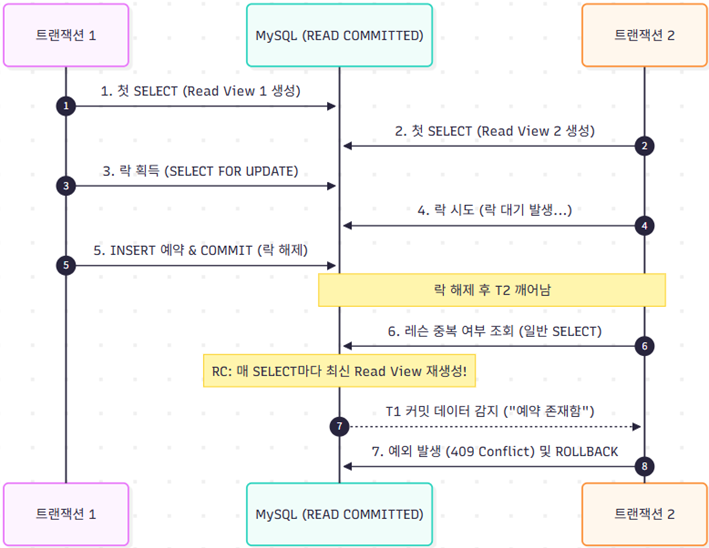
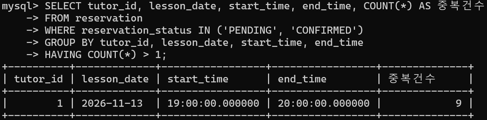
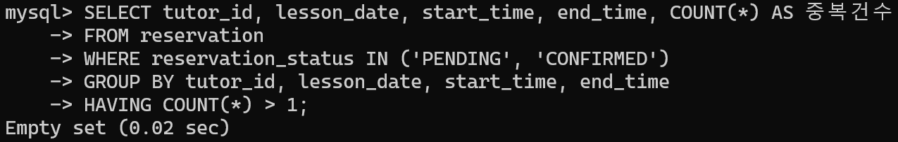
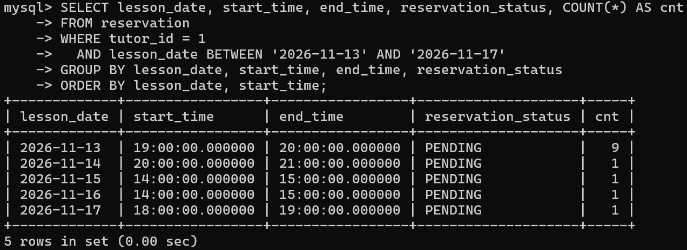
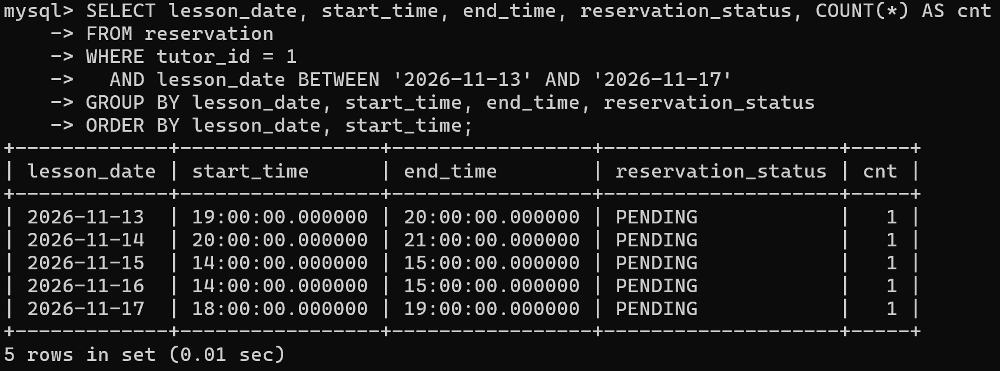

# DB 격리 수준 변화를 통한 Race Condition 문제 해결 (Repeatable Read VS Read Committed)

> **문서 목적:**  
> 레슨 예약 시스템에서 동일 튜터의 동일 시간대에 복수의 학생이 동시에 예약하는 **Double Booking(중복 예약)** 을 방지하기 위해 **튜터 행에 비관적 배타 락(X-Lock)** 을 적용했음에도, MySQL 기본 격리 수준인 **Repeatable Read(RR)** 환경에서 동시성 제어가 실패했던 원인을 InnoDB 엔진의 **MVCC Read View 생성 시점** 관점에서 파악하고, **READ COMMITTED(RC)** 전환을 통해 정합성을 확보한 과정과 트레이드오프를 정리.

---

## 1. 비즈니스 규칙

### 1) 시스템 요구사항 및 도메인 규칙
* **단일 예약 원칙:** 1명의 튜터는 특정 날짜의 동일한 시간대(예: `2026-10-29 19:00 ~ 20:00`)에 **단 1건의 레슨 예약**만 수락 가능. 따라서 시간 범위가 겹치는지 조회하는 **애플리케이션 검증 로직**이 필수적.

### 2) 레슨 예약 트랜잭션 흐름 ([`LessonMatchingService.java`](../../src/main/java/com/lessonmatchingplatform/lesson_matching_platform/lesson/service/LessonMatchingService.java#L152))
하나의 예약 요청이 처리되는 순:

1. **매칭 상태 검증 (일반 `SELECT`):** 학생-튜터 간 `Matching(ACCEPTED)` 상태가 존재하는지 검증
2. **정기 일정 및 휴무 예외 검증:** Redis 캐시 기반으로 튜터의 정기 수업 가능 시간 및 휴무 시간과 충돌하지 않는지 검증
3. **[직렬화 시도] 튜터 행 비관적 배타 락(`SELECT ... FOR UPDATE`):** `tutorsRepository.findByIdWithLock(tutorId)`를 호출하여 튜터 레코드에 X-Lock을 획득
4. **시간대 중복 예약 조회 (일반 `SELECT`):** `reservationRepository.existsOverlappingReservation(...)`을 호출하여 해당 시간대에 이미 확정/대기 중인 예약이 있는지 확인
5. **예약 생성 및 저장:** 겹치는 예약이 없으면 신규 `Reservation(PENDING)` 엔티티를 생성하고 `save()` (INSERT) 수행

---

## 2. 문제 원인 

### 1) 발생한 장애 현상: 튜터 행 락을 걸었는데 중복 예약이 생성됨
* **동시성 부하 테스트 환경:** 동일 튜터의 동일 슬롯(`19:00 ~ 20:00`)에 50명의 가상 유저(vUser)가 경합하는 예약 요청 전송
* **기대 결과:** 단 1건만 예약 생성에 성공(201 Created)하고, 나머지 49건은 시간 중복 예외로 롤백(409 Conflict)
* **실제 결과 (Repeatable Read):** **단 1건이 아닌 총 9건의 중복 예약(Double Booking)이 DB에 저장됨 (정상 1건 + 중복 8건)**

---

### 2) 근본 원인: InnoDB Repeatable Read의 Read View 생성 시점 함정

<p align="center">
  
</p>

#### (1) Repeatable Read에서 Read View의 생성 시점
* MySQL InnoDB의 `REPEATABLE READ` 격리 수준에서 **스냅샷(Read View)** 은  **"트랜잭션 내에서 첫 번째 읽기(Non-locking SELECT) 쿼리가 실행되는 순간"** 생성됨.
* 한 번 생성된 Read View는 트랜잭션이 커밋되거나 롤백될 때까지 변경되지 않으며, **이후 다른 트랜잭션이 데이터를 수정하고 커밋하더라도 첫 번째 쿼리 시점의 스냅샷만 계속 조회**.

#### (2) 코드 내 실행 순서의 함정
* `LessonMatchingService.createLessonMatchingReservation` 메서드 진입 시:
  * `matchingRepository.findByStudentIdAndTutorId(...)` (일반 `SELECT`)가 실행.
  * **바로 이 시점에 각 트랜잭션의 Read View가 독립적으로 생성되어 영구 고정.**
  * 이때는 어떤 트랜잭션도 레슨 예약을 INSERT하지 않았으므로, 생성된 Read View에는 **예약 없음**으로 기록됨.

#### (3) 튜터 행 락(X-Lock)의 착시와 MVCC 고립
* 나머지 트랜잭션은 `findByIdWithLock(tutorId)`를 실행하면서 첫 번째 트랜잭션이 튜터 행에 걸어둔 배타 락(X-Lock) 때문에 대기 상태에 들어감.
* 첫 번째 트랜잭션이 예약을 정상적으로 `INSERT`하고 트랜잭션을 **COMMIT**하면, 튜터 행의 락이 해제되면서 대기 중이던 두 번째 트랜잭션이 깨어나 락을 획득.
* 두 번째 트랜잭션은 이제 겹치는 예약이 있는지 확인하기 위해 `existsOverlappingReservation(...)`을 호출.
  * **하지만 이 조회는 락킹 읽기(`FOR UPDATE`)가 아닌 일반 `SELECT`.**
  * 따라서 InnoDB 엔진은 직전에 획득한 배타 락과 무관하게, **트랜잭션 맨 처음에 생성되었던 자신의 Read View를 기반으로 조회를 수행**.
  * 첫 번째 트랜잭션이 이미 커밋한 예약 행은 두 번째 트랜잭션의 Read View 생성 시점 이후의 데이터이므로, **두 번째 트랜잭션의 눈에는 여전히 예약이 없는 것으로 보임.**
  * 결국 두 번째 트랜잭션도 중복 예약을 `INSERT`하고 커밋. 동일한 원리로 나머지 트랜잭션 역시 중복 예약을 연달아 생성.

---

## 3. 해결 방법

### 1) 핵심 해결책: 격리 수준을 `READ COMMITTED(RC)`로 전환
이 문제를 해결하기 위해 예약 생성 트랜잭션의 격리 수준을 **`READ COMMITTED`**로 변경.

```java
@Transactional(
    timeout = 3, 
    isolation = Isolation.READ_COMMITTED // RR의 고정 Read View 문제를 해결하기 위해 RC로 전환
)
public LessonMatchingReservationResponse createLessonMatchingReservation(
        Long studentId,
        LessonMatchingReservationRequest request
) {
    // 1. 매칭 상태 검증 (일반 SELECT -> RC에서는 매 쿼리마다 새 Read View 생성)
    Matching matching = matchingRepository.findByStudentIdAndTutorId(studentId, request.tutorId())
            .orElseThrow(() -> new IllegalStateException("ACCEPTED 매칭이 없습니다."));

    // 2. 튜터 정기 일정 및 휴무 검증 (캐시 조회)
    tutorScheduleQueryService.validateReservableTime(request.tutorId(), request.startTime(), request.endTime());

    // 3. 튜터 행 비관적 배타 락 획득 (SELECT ... FOR UPDATE) -> 동시 요청 직렬화
    tutorsRepository.findByIdWithLock(request.tutorId())
            .orElseThrow(() -> new IllegalArgumentException("존재하지 않는 튜터입니다."));

    // 4. 중복 예약 여부 검증 (일반 SELECT)
    // -> RC 격리 수준이므로, 락 대기에서 깨어난 시점에 '새로운 최신 Read View'를 생성하여
    //    직전에 커밋된 T1의 예약 내역을 정확히 감지!
    boolean isAlreadyReserved = reservationRepository.existsOverlappingReservation(
            request.tutorId(), request.startTime(), request.endTime());
    if (isAlreadyReserved) {
        throw new IllegalStateException("해당 시간대에 이미 예약이 존재합니다.");
    }

    // 5. 신규 예약 저장
    Reservation reservation = Reservation.create(matching, request.startTime(), request.endTime());
    Reservation saved = reservationRepository.save(reservation);
    return LessonMatchingReservationResponse.from(saved);
}
```

---

### 2) READ COMMITTED 적용 후 동작 변화 시퀀스 다이어그램

`READ COMMITTED` 격리 수준에서는 **트랜잭션 시작 시점이 아니라, "모든 일반 `SELECT` 쿼리가 실행될 때마다 매번 최신 커밋 상태의 Read View를 새로 생성"**.

<br>

<p align="center">
  
</p>

<br>

1. T2가 `SELECT tutor FOR UPDATE`에서 대기하다가 T1 커밋 후 락을 얻고 깨어남.
2. T2가 `existsOverlappingReservation(...)`을 호출할 때, **READ COMMITTED 엔진은 과거의 스냅샷을 버리고 현재 커밋된 가장 최신 상태의 Read View를 즉시 생성**.
3. 방금 T1이 커밋한 예약 행이 즉시 눈에 보이므로 `isAlreadyReserved = true`가 됨.
4. T2는 `IllegalStateException`을 던지며 안전하게 트랜잭션을 롤백하고, 클라이언트에게 409 Conflict를 반환.

---

## 4. 결과

* **테스트 조건:** 동일 튜터(`tutor_id = 1`)에 대해 가상 유저 50명이 11월 13일 특정 시간 슬롯에 80% 집중되도록 동시 예약 요청 경합 (`ReservationConcurrencyTest`)
* **정합성 검증 쿼리 1 (중복 예약 여부 확인):**
  ```sql
  SELECT tutor_id, lesson_date, start_time, end_time, COUNT(*) AS 중복건수
  FROM reservation
  WHERE reservation_status IN ('PENDING', 'CONFIRMED')
  GROUP BY tutor_id, lesson_date, start_time, end_time
  HAVING COUNT(*) > 1;
  ```
* **정합성 검증 쿼리 2 (전체 슬롯별 예약 분포 확인):**
  ```sql
  SELECT lesson_date, start_time, end_time, reservation_status, COUNT(*) AS cnt
  FROM reservation
  WHERE tutor_id = 1 
    AND lesson_date BETWEEN '2026-11-13' AND '2026-11-17'
  GROUP BY lesson_date, start_time, end_time, reservation_status
  ORDER BY lesson_date, start_time;
  ```

<br>

#### [부하 테스트 실측 결과 비교 (Before vs After)]

##### 1. 중복 예약(HAVING COUNT > 1) 발생 여부 비교
| Before: Repeatable Read (스냅샷 고립으로 9건 중복 발생) | After: Read Committed (최신 Read View 갱신으로 0건 방어) |
|:---:|:---:|
|  |  |

<br>

##### 2. 전체 슬롯별 예약 상태 분포 비교 (11/13 집중 슬롯)
| Before: Repeatable Read (11/13 슬롯에 cnt=9) | After: Read Committed (모든 슬롯 cnt=1) |
|:---:|:---:|
|  |  |

<br>

| 검증 지표 | Before (REPEATABLE READ) | After (READ COMMITTED) |
|:---|:---:|:---:|
| **경합 슬롯(11/13) 중복 예약 건수** | **9건 중복 생성 (`중복건수=9`)** | **0건 (`Empty set`, 완전 차단)** | 
| **전체 슬롯별 예약 상태** | 11/13 슬롯에 **`cnt=9` 몰림** | 전 슬롯 **정확히 `cnt=1`씩 유지** | 
| **성공 응답 (201 Created)** | **다수 성공 (비정상 승인)** | **단 1 건 (정확)** | 
| **정상 차단 (409 Conflict)** | 차단 실패 | **나머지 전원 안전 차단** | 

---

## 5. 결과 요약

### 1) 핵심 의사결정 요약

| 구분 | 문제 상황 (Before) | 해결 방안 (After) | 선정 이유 및 기술적 근거 | 최종 결과 |
|:---|:---|:---|:---|:---|
| **트랜잭션 격리 수준** | **MySQL 기본값 (`REPEATABLE READ`)** | **`READ COMMITTED` 로 하향 조정** | • RR 격리수준은 트랜잭션의 **첫 SELECT 시점에 Read View가 고정**됨<br>• 선행 트랜잭션이 락을 해제하고 커밋해도, 대기하던 후행 트랜잭션은 과거 스냅샷을 조회해 **Double Booking(Race Condition) 발생**<br>• RC 격리수준은 **매 SELECT마다 최신 커밋 상태의 Read View를 재생성**하므로 선행 커밋 데이터를 즉시 감지 가능 | • 동일 슬롯 중복 예약: **9건 ➔ 0건 (완전 차단)**<br>• 선착순 1건만 정상 예약, 나머지 49건 안전 차단 |

---
