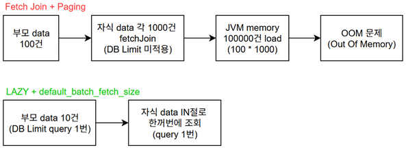
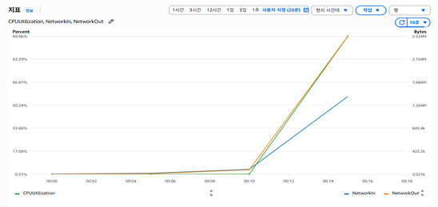
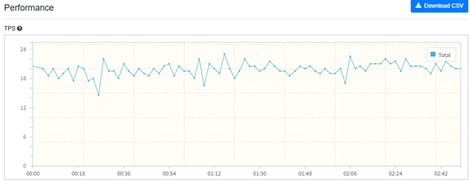
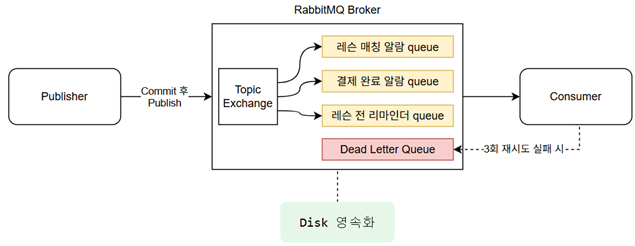

# 4. 추가 설계 결정

---

## 1. fetchJoin과 Paging을 함께 사용 시 발생하는 OOM 문제 해결

### 📌 문제 상황
- `fetchJoin`을 활용하여 일대다 또는 다대다 연관관계 테이블을 Join 후 전체 데이터를 fetch하면 카테시안 곱(Cartesian Product)만큼 데이터 Row가 급증하게 됨.
- 이때 Paging(Limit/Offset)을 함께 적용할 경우, Hibernate는 DB 레벨의 Limit 쿼리를 적용하지 못하고 **전체 데이터를 DB에서 조회하여 JVM 메모리로 가져온 후 인메모리 페이징**을 시도함.
- 결과적으로 메모리 과부하로 인한 **OOM(Out Of Memory)** 오류가 발생합니다.

### 💡 해결 방안
- **`FetchJoin` 제거**: 쿼리에서 direct `fetchJoin`을 제거.
- **`default_batch_fetch_size` 설정**: `default_batch_fetch_size`를 적용하여 지연 로딩 시 연관 데이터를 `IN` 절로 묶어 한 번에 쿼리(1번)로 묶어서 조회하도록 개선.
- 이를 통해 DB Limit 쿼리를 수행하면서 쿼리 횟수와 메모리 로딩 부담을 최소화.

---

## 2. CPU 성능에 맞춘 Bcrypt Hashing 전용 Thread Pool 제한

| AWS CloudWatch CPU 지표 모니터링 | nGrinder TPS 성능 모니터링 |
| :---: | :---: |
|  |  |

### 📌 문제 상황 
- nGrinder 부하 테스트 결과($vUser = 50$), 로그인 동시 요청 폭주 시 CPU 사용률이 100%에 도달하며 비밀번호 `Bcrypt Hashing` 연산 처리 TPS가 20으로 제한되는 현상을 확인.
- Bcrypt Hashing은 **CPU-Bound Job**로, 별도 제한 없이 Tomcat 기본 스레드(200개)가 동시 연산에 몰릴 경우 200개 스레드가 전부 Hashing 연산 대기에 묶여 **전체 애플리케이션 Thread Pool 고갈**로 이어짐.

### 💡 해결 방안 
- **비동기 스레드 풀 분리**: `@Async("bcryptExecutor")`를 통해 Bcrypt 연산 전용 비동기 스레드를 20개로 제한 위임했습니다.
- **성능 및 안정성 보장**: CPU Bound 특성상 스레드를 20개로 제어하더라도 최대 처리 성능은 TPS 20으로 동일하게 유지되며, 다른 일반 HTTP 요청 스레드가 고갈되지 않도록 격리.
- **과부하 차단**: Queue 크기를 50개로 제한하여 초과 요청 시 `429 Too Many Requests` 상태 코드로 즉시 거절하여 서버 다운을 방지.

---

## 3. 결제 및 매칭 알림(SMS) 처리를 위한 RabbitMQ 비동기 메시지 큐 도입

### 📌 문제 상황
- 결제 및 레슨 매칭 완료 알림(SMS)은 손실되어서는 안 되는 주요 트랜잭션 알림.
- 기존 Spring `@Async` 방식 사용 시, 작업이 JVM 메모리 큐에 보관되기 때문에 배포에 따른 서버 재시작이나 장애 발생 시 대기 중인 알림이 전량 소실되는 위험이 존재.

### 💡 해결 방안
- **RabbitMQ 큐 및 메시지 영속화** 도입:
  - 알림 메시지를 브로커 디스크에 영속 기록하여 서버 재기동 시에도 즉시 소비(Consume)되어 안전하게 발송되도록 구축.
- **지수 백오프 & DLQ(Dead Letter Queue) 격리**:
  - 외부 SMS API 호출 실패 시 최대 3회까지 지수 백오프로 재시도하며, 최종 실패한 메시지는 DLQ로 격리하여 유실을 방지.
- **트랜잭션 일관성 보장 (`AFTER_COMMIT`)**:
  - 메시지 발행 시점을 메인 DB 트랜잭션의 `AFTER_COMMIT` 이벤트로 지정하여, 트랜잭션 롤백 시 유령 알림이 발송되는 부작용을 완화 (`at-least-once` 보장).